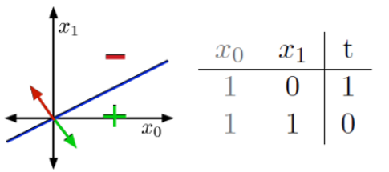
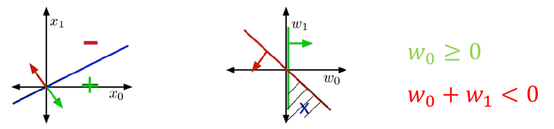
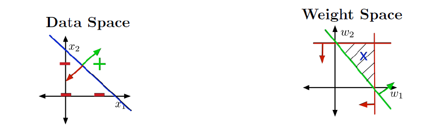
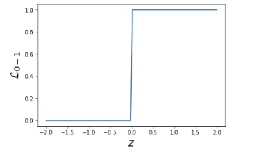
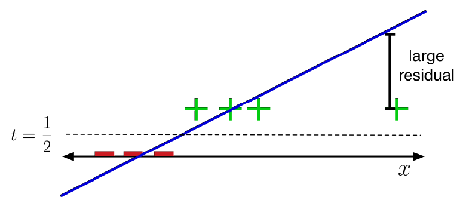
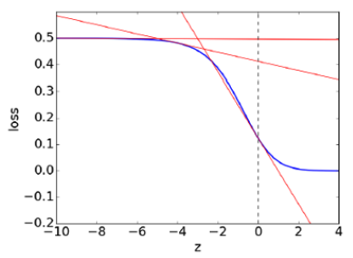
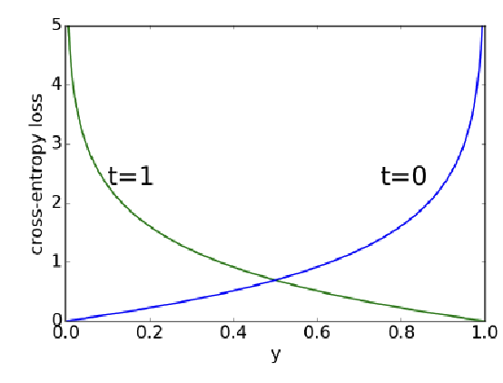
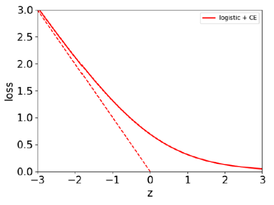
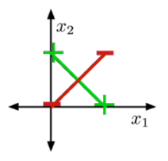
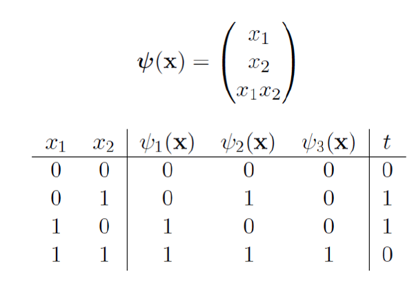

    
# L3 Linear Classifiers, Logistic Regression, Multiclass Classification

- **Classification 分类:** predict a discrete-valued target 离散值目标.
- **Binary classification 二分类:** two categories, e.g. spam / non-spam.
- **Multiclass classification 多分类:** more than two categories, e.g. handwritten digits 0–9.
- L2 predicts a real number; L3 predicts a category. 本节先讨论如何用线性边界分类，再引入适合优化的概率输出和损失函数。

## Binary Linear Classification 二元线性分类

### Setup and Model

- Input: $\mathbf{x}\in\mathbb{R}^{D}$, a vector of features.
- Target: $t\in\{0,1\}$.
  - $t=1$: **positive example 正例**.
  - $t=0$: **negative example 负例**.
  - Some algorithms use $\{-1,+1\}$ instead. 标签编码不同，使用公式前要先确认。
- Compute a linear score, then apply a **threshold 阈值** $r$:

$$
z=\mathbf{w}^{\mathsf T}\mathbf{x}+b,
\qquad
y=
\begin{cases}
1,&z\ge r,\\
0,&z<r.
\end{cases}

$$

$z$ 是连续的打分，$y$ 是最终的类别。权重决定各特征的影响，偏置决定边界的位置。

### Simplifications

**1. Eliminating the threshold 消去阈值**

$$
\mathbf{w}^{\mathsf T}\mathbf{x}+b\ge r
\iff
\mathbf{w}^{\mathsf T}\mathbf{x}+(b-r)\ge0

$$

把 $b-r$ 当作新的偏置，就可以 **without loss of generality (WLOG) 不失一般性地** 令阈值为 0。

**2. Eliminating the bias 合并偏置**

Add a **dummy feature 常数特征** $x_0=1$ and let $w_0$ equal the new bias:

$$
\mathbf{x}=(1,x_1,\ldots,x_D)^{\mathsf T},
\qquad
\mathbf{w}=(w_0,w_1,\ldots,w_D)^{\mathsf T}

$$

$$
z=\mathbf{w}^{\mathsf T}\mathbf{x},
\qquad
y=\mathbb{I}[z\ge0]

$$

- $\mathbb{I}[\cdot]$ is an **indicator function 指示函数**: 条件成立为 1，否则为 0。
- 这里的输入变为 $D+1$ 维。偏置没有消失，只是写进了向量中。

### Example 1: NOT 非运算

| $x_0$ | $x_1$ | Target $t$ | Condition   |
| ------- | ------- | ------------ | ------------- |
| 1     | 0     | 1          | $w_0\ge0$   |
| 1     | 1     | 0          | $w_0+w_1<0$ |

One solution is $w_0=1,\;w_1=-2$:

$$
z=1-2x_1

$$

- $x_1=0\Rightarrow z=1\Rightarrow y=1$.
- $x_1=1\Rightarrow z=-1\Rightarrow y=0$.
- The solution is **not unique**. 例如 $(w_0,w_1)=(2,-4)$ 也满足条件；将一组可行权重乘以正数，不会改变分类结果。

### Example 2: AND 与运算

Only predict 1 when both inputs are 1.

$$
z=w_0+w_1x_1+w_2x_2

$$

| $x_1$ | $x_2$ | $t$ | Condition         |
| ------- | ------- | ----- | ------------------- |
| 0     | 0     | 0   | $w_0<0$           |
| 0     | 1     | 0   | $w_0+w_2<0$       |
| 1     | 0     | 0   | $w_0+w_1<0$       |
| 1     | 1     | 1   | $w_0+w_1+w_2\ge0$ |

One solution is $w_0=-1.5,\;w_1=w_2=1$:

$$
z=-1.5+x_1+x_2

$$

四个输入的得分依次为 $-1.5,-0.5,-0.5,0.5$，因此只有 $(1,1)$ 被分到正类。

## The Geometric Picture 几何解释

### Input Space / Data Space 输入空间

- Training examples are **points**.
- A fixed weight vector defines two **half-spaces 半空间**:

$$
H_+=\{\mathbf{x}:\mathbf{w}^{\mathsf T}\mathbf{x}\ge0\},
\qquad
H_-=\{\mathbf{x}:\mathbf{w}^{\mathsf T}\mathbf{x}<0\}

$$

- The **decision boundary 决策边界** is:

$$
\mathbf{w}^{\mathsf T}\mathbf{x}=0

$$

- In 2-D it is a line; in higher dimensions it is a **hyperplane 超平面**.
- Data is **linearly separable 线性可分** if a linear decision rule can classify every training example correctly. 如果决策边界可以区分每个样本

图中的点代表样本，直线代表选定权重下的分类边界。

**为什么说边界经过原点？** 在加入 $x_0$ 的扩展空间中，方程是 $\mathbf{w}^{\mathsf T}\mathbf{x}=0$，所以经过该空间的原点。但实际样本都位于 $x_0=1$ 的切片上；回到原始特征空间，边界是 $w_1x_1+\cdots+w_Dx_D+b=0$，**不一定经过原点**。

### Weight Space 权重空间

- Weight vectors are **points**.
- Each training example imposes a **constraint 约束** on the weights:

$$
\begin{cases}
\mathbf{w}^{\mathsf T}\mathbf{x}^{(i)}\ge0,&t^{(i)}=1,\\
\mathbf{w}^{\mathsf T}\mathbf{x}^{(i)}<0,&t^{(i)}=0.
\end{cases}

$$

- The **feasible region 可行域** is the intersection of all these constraints.
- Nonempty intersection: **feasible 可行**, meaning perfect training classification is possible.
- Empty intersection: **infeasible 不可行**, meaning no weights satisfy all the constraints.

对 NOT，必须同时满足 $w_0\ge0$ 和 $w_0+w_1<0$。图（右）中的阴影区域表示可用的权重组合；其中的点不是训练样本。

- **左图 Data Space:** 固定权重 $(-1.5,1,1)$，在 $x_0=1$ 的切片中看样本，边界为 $x_1+x_2=1.5$。
- **右图 Weight Space:** 固定 $w_0=-1.5$，寻找符合 $w_1<1.5,\;w_2<1.5,\;w_1+w_2\ge1.5$ 的权重。

### Finding the Weights

- For linearly separable data, we can use **linear programming 线性规划** or the **perceptron algorithm 感知机算法**.
- Many real datasets are not linearly separable. We then need a loss function to measure errors and optimize the overall cost.
- 完美拟合训练集也不等于能泛化到新数据；这里的例子主要用于理解模型的表达能力。

## Towards Logistic Regression 逻辑回归

### Attempt 1: 0-1 Loss

The most direct classification loss counts whether the prediction is wrong:

$$
\mathcal{L}_{0-1}(y,t)
=
\begin{cases}
0,&y=t,\\
1,&y\ne t
\end{cases}
=\mathbb{I}[y\ne t]

$$

The average loss is the **misclassification rate 错误分类率**:

$$
\mathcal{J}(\mathbf{w})
=\frac1N\sum_{i=1}^{N}\mathbb{I}[y^{(i)}\ne t^{(i)}]

$$

**Problem: how do we optimize it?**

NP-hard

- As a function of the score $z$, the loss is piecewise constant 分段常数 and discontinuous 非连续的 at the decision threshold.
- Its derivative is zero wherever it is defined; at the jump it is undefined.

$$
\frac{\partial\mathcal{L}_{0-1}}{\partial w_j}
=
\frac{\partial\mathcal{L}_{0-1}}{\partial z}
\frac{\partial z}{\partial w_j}
=0
\qquad\text{away from the threshold}

$$

小幅调整权重通常不会改变最终类别，因此损失不变。即使模型分错了，梯度也不能告诉我们应该往哪里走。**梯度为零不代表预测正确，也不代表已经找到最优解。**

### Attempt 2: Linear Regression with Squared Error

relaxation with a smooth surrogate loss function 利用平滑替代损失函数进行的松弛: Use a smooth **surrogate loss 替代损失** that is easier to optimize. 用更容易优化的函数代替直接计算“对或错”的损失。

$$
z=\mathbf{w}^{\mathsf T}\mathbf{x},
\qquad
\mathcal{L}_{\mathrm{SE}}(z,t)=\frac12(z-t)^2

$$

- Treat binary targets as numerical values 0 and 1.
- Predict class 1 if $z\ge\frac12$, otherwise class 0.
- $z$ 是预测 $t$ 是答案
- 为什么用 $\frac12$？这是 0 和 1 的中点，得分超过中点就更接近标签 1； $1/2$是决策阀值 Threshold。

**Problem:** squared error penalizes scores that are far from the numerical target, even if the predicted class is correct. 平方误差的惩罚

For $t=1$:

$$
\mathcal{L}_{\mathrm{SE}}(10,1)=\frac12(10-1)^2=40.5,
\qquad
\mathcal{L}_{\mathrm{SE}}(0,1)=\frac12(0-1)^2=0.5

$$

$z=10$ 已经在正类一侧，却比错误预测 $z=0$ 受到更大的惩罚。平方误差要求得分接近数值 1，而分类主要关心类别是否正确。

### Attempt 3: Logistic Activation Function 逻辑激活函数

$$
\underbrace{选择概率阈值0.5}_{定义规则}
\;\Rightarrow\;
\underbrace{对应分数阈值0}_{由sigmoid推导}
\;\Rightarrow\;
\underbrace{\mathbf w^\top\mathbf x=0}_{得到决策边界}.

$$

There’s obviously no reason to predict values outside $[0, 1]$. Let’s squash 𝑦 into this
interval.

Squash the score into $(0,1)$ using the **logistic function**, a sigmoid / S-shaped function:

$$
\boxed{\sigma(z)=\frac{1}{1+e^{-z}}}

$$

- $z\to+\infty\Rightarrow\sigma(z)\to1$.
- $z\to-\infty\Rightarrow\sigma(z)\to0$.
- $\sigma(0)=\frac12$.
- Here $\sigma$ is an **activation function 激活函数**.

$$
z=\mathbf{w}^{\mathsf T}\mathbf{x},
\qquad
y=\sigma(z)

$$

从这里开始，$y$ 表示连续的概率输出。为避免混淆，用 $\hat t$ 表示最终预测类别：

$$
\mathbf x
\xrightarrow{\;\mathbf w^\top\mathbf x\;}
z\text{（分数）}
\xrightarrow{\;\sigma\;}
y\text{（概率）}
\xrightarrow{\;与0.5比较\;}
\hat t\text{（预测类别）}

$$

$$
\hat t=\mathbb{I}[y\ge0.5]=\mathbb{I}[z\ge0]

$$

The inverse function is the **logit 对数几率**:

$$
\sigma^{-1}(y)=\log\frac{y}{1-y}=z

$$

$y/(1-y)$ 是正类与负类的概率之比；取对数后，得到线性得分 $z$。本节 $\log$ 均表示自然对数。

#### Why not keep squared error? (sigmoid 加平方误差)

Suppose we still use:

$$
\mathcal{L}_{\mathrm{SE}}(y,t)=\frac12(y-t)^2

$$

First, the derivative of the sigmoid is:

$$
\begin{aligned}
\sigma'(z)
&=\frac{e^{-z}}{(1+e^{-z})^2}\\
&=\frac1{1+e^{-z}}\left(1-\frac1{1+e^{-z}}\right)\\
&=y(1-y)
\end{aligned}

$$

Apply the chain rule:

$$
\frac{\partial\mathcal{L}_{\mathrm{SE}}}{\partial z}
=(y-t)y(1-y)

$$

$$
\frac{\partial\mathcal{L}_{\mathrm{SE}}}{\partial w_j}
=(y-t)y(1-y)x_j

$$

- If $t=1$
  - but $z\ll0$, then $y\approx0$: the prediction is very wrong.
  - However, $y(1-y)\approx0$, so the gradient is also close to zero for fixed finite inputs. 即使预测很错，梯度也很小，权重调整可能非常缓慢
- 图的左侧损失较大，但曲线很平。模型“非常自信地分错”，参数却几乎不更新。这是 sigmoid **saturation 饱和**导致的优化困难。

## Logistic Regression 逻辑回归

Despite its name, logistic regression is used for **classification**.

- Interpret $y$ as the estimated probability of the positive class:

$$
y=P(t=1\mid\mathbf{x}),
\qquad
1-y=P(t=0\mid\mathbf{x})

$$

### Cross-Entropy Loss 交叉熵损失

Use **binary cross-entropy**, also called **log loss 对数损失**: $t$ 为真实标签

$$
\mathcal{L}_{\mathrm{CE}}(y,t)
=
\begin{cases}
-\log y,&t=1,\\
-\log(1-y),&t=0.
\end{cases}

$$

Equivalently:

$$
\boxed{
\mathcal{L}_{\mathrm{CE}}(y,t)
=-t\log y-(1-t)\log(1-y)
}

$$

$t$ 是 0 或 1，所以公式自动保留真实类别对应的那一项。**模型分配给真实类别的概率越低，损失越大。**

For $t=1$:

$$
\mathcal{L}_{\mathrm{CE}}(y,t)
=-\log y
$$

$$

L=-\ln y
=-\ln\frac{1}{1+e^{-z}}
=\boxed{\ln(1+e^{-z})}.

$$
| Predicted probability $y$ | Loss $-\log y$ | 中文理解                 |
| --------------------------- | ---------------- | -------------------------- |
| 0.99                      | $\approx0.010$ | 高概率预测正确，损失很小 |
| 0.50                      | $\approx0.693$ | 模型不确定               |
| 0.01                      | $\approx4.605$ | 高度自信地分错，损失很大 |

For $t=0$, the same reasoning applies to $1-y$.

图中真实标签是 1。

- $z$ 越大，$y \approx 1$ 正类概率越高，损失越接近 0；
- $z$ 很小时损失较大，但斜率不会像 sigmoid 加平方误差那样趋近 0（训练还能得到纠错信号。**负梯度**会推动 $z$ 增大，进而提高正确类别的概率。

### Model and Cost

$$
\boxed{
\begin{aligned}
z&=\mathbf{w}^{\mathsf T}\mathbf{x}\\
y&=\sigma(z)\\
\mathcal{L}_{\mathrm{CE}}(y,t)&=-t\log y-(1-t)\log(1-y)
\end{aligned}
}

$$

$$
\mathcal{J}(\mathbf{w})
=\frac1N\sum_{i=1}^{N}
\mathcal{L}_{\mathrm{CE}}(y^{(i)},t^{(i)})

$$

- There is generally no **closed-form solution 闭式解** analogous to the normal equation in linear regression.
- The logistic cross-entropy cost is **convex in $\mathbf{w}$ 关于权重是凸函数**.
- We can optimize it with gradient descent or SGD, as in L2.
- A standard initialization is $\mathbf{w}=\mathbf{0}$: all scores are 0 and all probabilities are 0.5. 此时 sigmoid 的导数为 $1/4$，没有进入饱和区（此时改变 $z$，sigmoid 输出 $y$ 还会明显变化，没有接近两端的平坦部分）。

### Gradient of Logistic Loss 梯度推导

The dependency is:

$$
w_j\longrightarrow z\longrightarrow y\longrightarrow\mathcal{L}_{\mathrm{CE}}

$$
$$
\mathcal{L}_{\mathrm{CE}}(y,t)
=-t\log y-(1-t)\log(1-y)
$$

$$
z=\mathbf w^\top\mathbf x,\qquad y=\sigma(z)
$$
**1. Differentiate the loss with respect to $y$**

$$
\begin{aligned}
\frac{\partial\mathcal{L}_{\mathrm{CE}}}{\partial y}
&=-\frac{t}{y}+\frac{1-t}{1-y}\\
&=\frac{-t(1-y)+(1-t)y}{y(1-y)}\\
&=\frac{y-t}{y(1-y)}
\end{aligned}

$$

**2. Differentiate the activation and the score**

$$
\frac{\partial y}{\partial z}=y(1-y),
\qquad
\frac{\partial z}{\partial w_j}=x_j

$$

**3. Apply the chain rule**

$$
\begin{aligned}
\frac{\partial\mathcal{L}_{\mathrm{CE}}}{\partial w_j}
&=\frac{\partial\mathcal{L}_{\mathrm{CE}}}{\partial y}
\frac{\partial y}{\partial z}
\frac{\partial z}{\partial w_j}\\
&=\frac{y-t}{y(1-y)}\;y(1-y)\;x_j\\
&=\boxed{(y-t)x_j}
\end{aligned}

$$

In particular:

$$
\boxed{\frac{\partial\mathcal{L}_{\mathrm{CE}}}{\partial z}=y-t}

$$

交叉熵的导数与 sigmoid 的 $y(1-y)$ 因子相消。当 $t=1,y\approx0$ 时，$\partial\mathcal{L}/\partial z\approx-1$，不会因为 sigmoid 饱和就接近 0。

**4. Average over the training set**

GD 更新 weights of logistic regression: $w_j \leftarrow w_j - \alpha \frac{\partial \mathcal{J}}{\partial w_j}$
$$
\frac{\partial\mathcal{J}}{\partial w_j}
=\frac1N\sum_{i=1}^{N}(y^{(i)}-t^{(i)})x_j^{(i)}

$$

$$
\boxed{
\mathbf{w}\leftarrow\mathbf{w}
-\frac{\alpha}{N}\sum_{i=1}^{N}(y^{(i)}-t^{(i)})\mathbf{x}^{(i)}
}

$$

如果偏置单独写，$\partial\mathcal{L}/\partial b=y-t$；如果已加入 $x_0=1$，偏置更新就包含在上述公式中。

### Vectorization 向量化

With the dummy feature included:

$$
\mathbf{X}\in\mathbb{R}^{N\times(D+1)},
\qquad
\mathbf{w}\in\mathbb{R}^{D+1},
\qquad
\mathbf{y},\mathbf{t}\in\mathbb{R}^{N}

$$

$$
\mathbf{z}=\mathbf{X}\mathbf{w},
\qquad
\mathbf{y}=\sigma(\mathbf{z})

$$

The sigmoid is applied **elementwise 逐元素地**.

$$
\boxed{
\nabla_{\mathbf{w}}\mathcal{J}
=\frac1N\mathbf{X}^{\mathsf T}(\mathbf{y}-\mathbf{t})
}

$$

$$
\mathbf{w}\leftarrow\mathbf{w}
-\frac{\alpha}{N}\mathbf{X}^{\mathsf T}(\mathbf{y}-\mathbf{t})

$$

### Comparison with Linear Regression

| Model               | Prediction $y$                             | Loss                      | Single-example gradient |
| --------------------- | -------------------------------------------- | --------------------------- | ------------------------- |
| Linear regression   | $\mathbf{w}^{\mathsf T}\mathbf{x}$         | $\frac12(y-t)^2$          | $(y-t)\mathbf{x}$       |
| Logistic regression | $\sigma(\mathbf{w}^{\mathsf T}\mathbf{x})$ | $-t\log y-(1-t)\log(1-y)$ | $(y-t)\mathbf{x}$       |

The update has the same form, but **$y$ is computed differently**. 两者都属于 generalized linear models 广义线性模型。

如果把平均损失改成损失之和，梯度扩大 $N$ 倍。要保持相同更新量，学习率应改为 $\alpha'=\alpha/N$。

## Multiclass Classification 多分类

- Binary classification: predicting a binary-valued target

- Multiclass classification: predicting a discrete-(>2)-valued target

### One-Hot Encoding 独热编码

Targets belong to $\{1,\ldots,K\}$. Represent a target as a **one-hot vector / one-of-K encoding**:

$$
\mathbf{t}=(0,\ldots,0,1,0,\ldots,0)^{\mathsf T}\in\mathbb{R}^{K}

$$

只有真实类别对应的位置为 1，其余为 0。例如 $K=3$，样本属于第 2 类：

$$
\mathbf{t}=(0,1,0)^{\mathsf T}

$$

这里讨论的是每个样本只有一个正确类别的多分类任务。

### Multiclass Linear Model

We need one score for each class:

$$
z_k=\sum_{j=1}^{D}w_{kj}x_j+b_k,
\qquad k=1,\ldots,K

$$

$$
\boxed{\mathbf{z}=\mathbf{W}\mathbf{x}+\mathbf{b}}

$$

- $\mathbf{W}\in\mathbb{R}^{K\times D}$: each row contains the weights for one class.
- $\mathbf{x}\in\mathbb{R}^{D}$: input features.
- $\mathbf{b}\in\mathbb{R}^{K}$: one bias per class.
- $\mathbf{z}\in\mathbb{R}^{K}$: class scores, also called **logits**.

$w_{kj}$ 表示第 $j$ 个特征对第 $k$ 类得分的影响。

As before, add $x_0=1$ and absorb the biases:

$$
\mathbf{W}\in\mathbb{R}^{K\times(D+1)},
\qquad
\mathbf{z}=\mathbf{W}\mathbf{x}

$$

A hard prediction chooses the highest score:

$$
\hat k=\arg\max_k z_k

$$

$\arg\max$ 返回最大值所在的**类别编号**，而不是最大值本身。

若需要 one-hot 预测，就将第 $\hat k$ 项设为 1；并列时采用固定规则选择一类。

$$
y_i=
\begin{cases}
1,&i=\arg\max_k z_k,\\
0,&其他情况.
\end{cases}
$$
假设分为猫、狗、鸟三类，模型算出的分数为：$\mathbf z=(2,5,1)$

e.g. 找到得分最高的类别编号
$\hat k=\arg\max_k z_k$
狗的分数最高，所以 $\hat k=2$（这里从 1 开始编号） $\mathbf y=(0,\;1,\;0)$
## Softmax Regression

### Softmax Activation

For optimization(We want soft predictions that are like probabilities, i.e., $0 \le y_k \le 1$ and $\sum_k y_k = 1$), replace the hard decision with a vector of probabilities:

$$
\boxed{
y_k=\operatorname{softmax}(\mathbf{z})_k
=\frac{e^{z_k}}{\sum_{j=1}^{K}e^{z_j}}
}

$$

- $0<y_k<1$ for finite scores when $K>1$.
- $\sum_{k=1}^{K}y_k=1$.
- $y_k$ is the estimated probability of class $k$.
- If one score is much larger than all others, its probability($\operatorname{softmax}(\mathbf{z})_k$) approaches 1.

先取指数，使每项为正；再除以总和，使所有类别的概率加起来为 1。

Example: $\mathbf{z}=(2,1,0)^{\mathsf T}$.

$$
\mathbf{y}
=\frac1{e^2+e^1+e^0}
\begin{pmatrix}e^2\\e^1\\e^0\end{pmatrix}
\approx
\begin{pmatrix}0.665\\0.245\\0.090\end{pmatrix}
$$
| 类别 | 分数 $z_k$ | 概率 $y_k$ |
|---|---:|---:|
| 类别 1 | 2 | $7.389/11.107\approx0.665$ |
| 类别 2 | 1 | $2.718/11.107\approx0.245$ |
| 类别 3 | 0 | $1/11.107\approx0.090$ |

The predicted class is 1. Softmax preserves the ordering of the scores:

$$
\arg\max_k y_k=\arg\max_k z_k

$$

**Connection to sigmoid:** for two classes,

$$
y_1=\frac{e^{z_1}}{e^{z_1}+e^{z_2}}
=\frac1{1+e^{-(z_1-z_2)}}
=\sigma(z_1-z_2)

$$

因此 softmax 可以看作 sigmoid 在多分类中的推广。

### Multiclass Cross-Entropy

$$
\boxed{
\mathcal{L}_{\mathrm{CE}}(\mathbf{y},\mathbf{t})
=-\sum_{k=1}^{K}t_k\log y_k
=-\mathbf{t}^{\mathsf T}\log\mathbf{y}
}

$$

#### 这一部分的推导

核心思路：**让模型给真实类别尽可能高的概率，并用这个概率的负对数作为损失。

1. 定义预测概率与真实标签

假设有 $K$ 个类别，模型通过 softmax 输出概率：

$$
y_k=\frac{e^{z_k}}{\sum_{j=1}^{K}e^{z_j}},
\qquad
\sum_{k=1}^{K}y_k=1.
$$

其中，$y_k$ 表示模型根据输入 $\mathbf x$，预测属于类别 $k$ 的概率。

真实标签用 one-hot 向量 $\mathbf t$ 表示。若真实类别为 $c$，则：

$$
t_k=
\begin{cases}
1,&k=c,\\
0,&k\ne c.
\end{cases}
$$

注意：$t_k=1$ 表示“真实类别是第 $k$ 类”，不是“预测正确”。

2. 用乘积表示模型给真实类别的概率

真实类别为 $c$ 时，模型给它的概率就是 $y_c$。利用 one-hot 标签，可以统一写成：

$$
P(\text{真实类别}\mid\mathbf x)
=\prod_{k=1}^{K}y_k^{t_k}.
$$

其中，$\prod$ 表示把各项乘起来。因为：

$$
y_k^{t_k}=
\begin{cases}
y_k,&t_k=1,\\
1,&t_k=0,
\end{cases}
$$

所以，**只有真实类别的概率被保留，其他项都变成 1**：

$$
\prod_{k=1}^{K}y_k^{t_k}=y_c.
$$

这里的乘积只是利用 one-hot 编码选出 $y_c$，并不是假设各类别相互独立。

例如，模型输出：

$$
\mathbf y=(0.665,\;0.245,\;0.090).
$$

若真实类别是 2，则：

$$
\mathbf t=(0,\;1,\;0).
$$

于是：

$$
\begin{aligned}
P(\text{真实类别}\mid\mathbf x)
&=0.665^0\times0.245^1\times0.090^0\\
&=1\times0.245\times1\\
&=0.245.
\end{aligned}
$$

这表示模型给真实答案“类别 2”分配了 **24.5% 的概率**，并不是说真实标签本身不确定。

3. 从最大化概率，到最小化负对数

训练希望模型给真实类别的概率越大越好，因此希望最大化：

$$
P(\text{真实类别}\mid\mathbf x).
$$

由于 $\log$ 单调递增，最大化概率等价于最大化它的对数；再加上负号，就变成最小化问题。因此定义损失：

$$
L=-\log P(\text{真实类别}\mid\mathbf x).
$$

这个定义满足：

- 给真实类别的概率越接近 1，损失越接近 0。
- 给真实类别的概率越接近 0，损失越大。

4. 展开，得到交叉熵公式

将乘积形式代入：

$$
\begin{aligned}
L_{\mathrm{CE}}(\mathbf y,\mathbf t)
&=-\log\left(\prod_{k=1}^{K}y_k^{t_k}\right)\\
&=-\sum_{k=1}^{K}\log\left(y_k^{t_k}\right)\\
&=-\sum_{k=1}^{K}t_k\log y_k.
\end{aligned}
$$

这里用了两条对数规则：

$$
\log(ab)=\log a+\log b,
\qquad
\log(a^b)=b\log a.
$$

因此，多分类交叉熵为：

$$
\boxed{
L_{\mathrm{CE}}(\mathbf y,\mathbf t)
=-\sum_{k=1}^{K}t_k\log y_k
}
$$

因为 $\mathbf t$ 是 one-hot，最终也可以直接写成：

$$
\boxed{L_{\mathrm{CE}}=-\log y_c},
\qquad c\text{ 为真实类别}.
$$

上面的例子中：

$$
\begin{aligned}
L_{\mathrm{CE}}
&=-[0\log0.665+1\log0.245+0\log0.090]\\
&=-\log0.245\\
&\approx1.406.
\end{aligned}
$$

5. 与二分类交叉熵的关系

二分类时：

- 类别 1 的概率为 $y$，对应的真实标签指示量为 $t$。
- 类别 0 的概率为 $1-y$，对应的真实标签指示量为 $1-t$。

代入多分类公式，得到：

$$
\boxed{
L_{\mathrm{CE}}
=-t\log y-(1-t)\log(1-y)
}
$$

因此，二分类与多分类交叉熵遵循同一个原则：**损失等于模型给真实类别的概率的负对数。**
$\log\mathbf{y}$ means taking the logarithm of each element.

If the true class is $c$, then $t_c=1$ and all other entries are 0:

$$
\mathcal{L}_{\mathrm{CE}}=-\log y_c

$$

只取真实类别概率的负对数。例如上面的概率中，若真实类别为第 2 类，则损失为 $-\log0.245\approx1.408$。

### Model and Cost

$$
\boxed{
\begin{aligned}
\mathbf{z}&=\mathbf{W}\mathbf{x}\\
\mathbf{y}&=\operatorname{softmax}(\mathbf{z})\\
\mathcal{L}_{\mathrm{CE}}&=-\mathbf{t}^{\mathsf T}\log\mathbf{y}
\end{aligned}
}

$$

$$
\mathcal{J}(\mathbf{W})
=\frac1N\sum_{i=1}^{N}
\mathcal{L}_{\mathrm{CE}}(\mathbf{y}^{(i)},\mathbf{t}^{(i)})

$$

### Gradient of Softmax Cross-Entropy 梯度推导

**1. Take the logarithm of softmax**

$$
\log y_k=z_k-\log\left(\sum_{j=1}^{K}e^{z_j}\right)

$$

**2. Substitute into the loss**

Since $\sum_k t_k=1$:

$$
\begin{aligned}
\mathcal{L}_{\mathrm{CE}}
&=-\sum_{k=1}^{K}t_k
\left[z_k-\log\left(\sum_{j=1}^{K}e^{z_j}\right)\right]\\
&=-\sum_{k=1}^{K}t_kz_k
+\log\left(\sum_{j=1}^{K}e^{z_j}\right)
\end{aligned}

$$

对数项与外层求和的 $k$ 无关，前面的系数是 $\sum_k t_k=1$。

**3. Differentiate with respect to one score $z_k$**

$$
\begin{aligned}
\frac{\partial\mathcal{L}_{\mathrm{CE}}}{\partial z_k}
&=-t_k+\frac{e^{z_k}}{\sum_{j=1}^{K}e^{z_j}}\\
&=\boxed{y_k-t_k}
\end{aligned}

$$

虽然最后形式很简单，但分母包含所有类别；改变一个得分，会影响整个概率向量。

**4. Differentiate with respect to the weights**

Let $\mathbf{w}_k$ be the column vector of weights for class $k$, so row $k$ of $\mathbf{W}$ is $\mathbf{w}_k^{\mathsf T}$:

$$
z_k=\mathbf{w}_k^{\mathsf T}\mathbf{x},
\qquad
\nabla_{\mathbf{w}_k}z_k=\mathbf{x}

$$

$$
\boxed{
\nabla_{\mathbf{w}_k}\mathcal{L}_{\mathrm{CE}}
=(y_k-t_k)\mathbf{x}
}

$$

Equivalently, for one element:

$$
\frac{\partial\mathcal{L}_{\mathrm{CE}}}{\partial w_{kj}}
=(y_k-t_k)x_j

$$

**5. Average and update**

$$
\boxed{
\mathbf{w}_k\leftarrow\mathbf{w}_k
-\frac{\alpha}{N}\sum_{i=1}^{N}
(y_k^{(i)}-t_k^{(i)})\mathbf{x}^{(i)}
}

$$

这与线性回归、逻辑回归一样，仍然是“预测减目标，再乘输入”。区别是现在每个类别都有自己的一组权重。

For one example, all rows can be written together as an **outer product 外积**:

$$
\nabla_{\mathbf{W}}\mathcal{L}_{\mathrm{CE}}
=(\mathbf{y}-\mathbf{t})\mathbf{x}^{\mathsf T}
\in\mathbb{R}^{K\times(D+1)}

$$

## Limits of Linear Classification 线性分类的局限

### XOR 异或

XOR outputs 1 when the two inputs are different:

| $x_1$ | $x_2$ | $t$ |
| ------- | ------- | ----- |
| 0     | 0     | 0   |
| 0     | 1     | 1   |
| 1     | 0     | 1   |
| 1     | 1     | 0   |

The positive and negative examples occupy opposite diagonals. No single straight line can separate the two classes.

### Geometric Proof 几何证明

- A half-space is **convex 凸的**: if two points lie in it, their connecting line segment also lies in it.
- 假设存在一条线能把 XOR 完全分开，那么两个正例之间的绿色线段应全部在正半空间中。
- 同样，两个负例之间的红色线段应全部在负半空间中。
- 但两条线段在 $(0.5,0.5)$ 相交。这个点不可能同时属于正半空间和负半空间，产生 **contradiction 矛盾**。

Therefore, XOR is not linearly separable.

### Algebraic Proof 代数验证

For $z=b+w_1x_1+w_2x_2$, perfect classification requires:

$$
\begin{aligned}
b&<0 &&\text{for }(0,0),\\
b+w_2&\ge0 &&\text{for }(0,1),\\
b+w_1&\ge0 &&\text{for }(1,0),\\
b+w_1+w_2&<0 &&\text{for }(1,1).
\end{aligned}

$$

Add the two positive-example constraints:

$$
2b+w_1+w_2\ge0

$$

But adding the two negative-example constraints gives:

$$
2b+w_1+w_2<0

$$

同一个式子不可能同时满足这两个条件，所以不存在可行权重。

### Feature Maps 特征映射

As in L2, we can introduce nonlinear features:

The new feature $x_1x_2$ identifies the case where both inputs are 1. One separating rule is:

$$
z=-\frac12+x_1+x_2-2x_1x_2,
\qquad
\hat t=\mathbb{I}[z\ge0]

$$

| $(x_1,x_2)$ | $x_1x_2$ | Score $z$ | Prediction $\hat t$ |
| ------------- | ---------- | ----------- | --------------------- |
| $(0,0)$     | 0        | $-0.5$    | 0                   |
| $(0,1)$     | 0        | $0.5$     | 1                   |
| $(1,0)$     | 0        | $0.5$     | 1                   |
| $(1,1)$     | 1        | $-0.5$    | 0                   |

- The classifier is **linear in the mapped features** but nonlinear in the original inputs.
- 在新空间里，$x_1x_2$ 是一个单独的输入特征，模型对这三个特征仍然做线性加权。
- Adding sigmoid alone does not solve XOR: thresholding $\sigma(\mathbf{w}^{\mathsf T}\mathbf{x}+b)$ at 0.5 still gives the boundary $\mathbf{w}^{\mathsf T}\mathbf{x}+b=0$.
- Feature maps are difficult to design manually. Neural networks can learn nonlinear feature maps from data, which is the topic of the next lecture.
